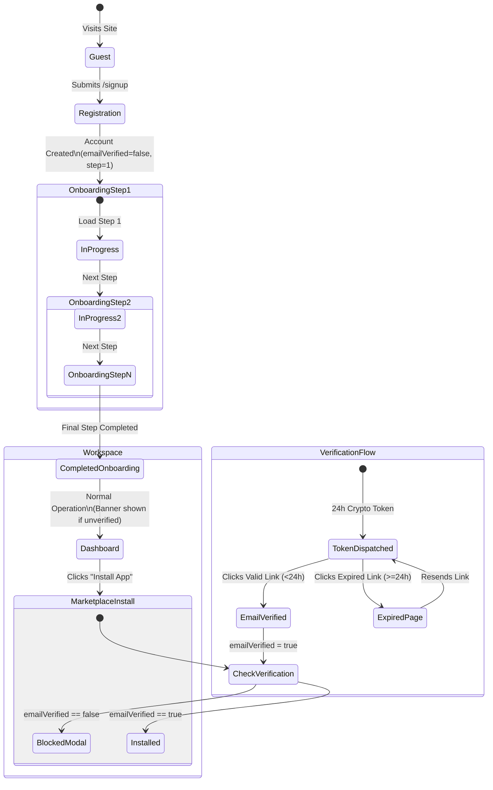

# Data Model: Identity, Authentication & Session Routing

**Feature**: `001-auth-session-routing`  
**Document ID**: `SPEC-AUTH-001`  
**Schema Source**: `packages/db/prisma/schema/core.prisma`  
**Compliance**: Core Domain Immutability Law (Zero changes to core schema required; leverages existing models & metadata)

---

## 1. Entity Definitions & Schema Mapping

The identity, authentication, and session management domain is backed by existing core platform models in PostgreSQL via Prisma (`@suite/db`).

### 1.1 User Model (`users`)
Represents the human operator across all organizations and modular apps.

| Field | Type | Attributes | Description |
| :--- | :--- | :--- | :--- |
| `id` | `String` | `@id @default(cuid())` | Unique user identifier. |
| `email` | `String` | `@unique @db.VarChar(255)` | Lowercase primary email address. |
| `name` | `String` | `@db.VarChar(191)` | Full display name. |
| `mobile` | `String?` | `@db.VarChar(32)` | Contact telephone / SMS number. |
| `emailVerified` | `Boolean` | `@default(false)` | Verification status (governs app install gate). |
| `image` | `String?` | `@db.Text` | Profile avatar URL. |
| `managerPinHash`| `String?` | `@db.VarChar(255)` | Argon2/Bcrypt hash for supervisor overrides. |
| `metadata` | `Json` | `@default("{}")` | User preferences & onboarding lifecycle attributes. |
| `createdAt` | `DateTime` | `@default(now())` | Account timestamp. |
| `updatedAt` | `DateTime` | `@updatedAt` | Last modification timestamp. |

#### User Metadata Schema (`User.metadata`)
```typescript
export interface UserMetadata {
  /** User visual theme preference */
  theme_preference?: "system" | "light" | "dark";
  /** Onboarding workflow lifecycle status */
  onboarding_status?: "NOT_STARTED" | "IN_PROGRESS" | "COMPLETED";
  /** Sequential onboarding checkpoint (1, 2, or 3) */
  current_onboarding_step?: 1 | 2 | 3;
  /** Optional user custom session expiration timeout override (e.g., 3600 or 7200) */
  session_timeout_seconds?: number;
  /** ISO timestamp when email verification link was last dispatched */
  last_verification_sent_at?: string;
  /** Account linking collision metadata */
  pending_oauth_link?: {
    providerId: string;
    accountId: string;
    email: string;
    expiresAt: number;
  };
}
```

---

### 1.2 Account Model (`accounts`)
Stores authentication credentials and federated OAuth provider links.

| Field | Type | Attributes | Description |
| :--- | :--- | :--- | :--- |
| `id` | `String` | `@id @default(cuid())` | Account link identifier. |
| `userId` | `String` | Foreign Key → `User.id` | Associated user reference. |
| `accountId` | `String` | `@db.VarChar(255)` | Provider subject ID or local email. |
| `providerId` | `String` | `@db.VarChar(64)` | Provider: `"credential"`, `"google"`, `"microsoft"`, `"github"`. |
| `password` | `String?` | `@db.Text` | Argon2/Scrypt hash for local credentials. |
| `accessToken` | `String?` | `@db.Text` | OAuth access token. |
| `refreshToken`| `String?` | `@db.Text` | OAuth refresh token. |
| `idToken` | `String?` | `@db.Text` | OpenID Connect identity token. |
| `accessTokenExpiresAt` | `DateTime?` | | Expiry time for access token. |
| `scope` | `String?` | `@db.Text` | Granted OAuth scopes. |
| `createdAt` | `DateTime` | `@default(now())` | Link creation timestamp. |

*Unique Constraint:* `@@unique([providerId, accountId])`  
*Index:* `@@index([userId])`

---

### 1.3 Session Model (`sessions`)
Tracks authenticated user sessions and active tenant/branch context.

| Field | Type | Attributes | Description |
| :--- | :--- | :--- | :--- |
| `id` | `String` | `@id @default(cuid())` | Unique session record ID. |
| `userId` | `String` | Foreign Key → `User.id` | Authenticated user reference. |
| `token` | `String` | `@unique @db.VarChar(255)` | Opaque session token or signature key. |
| `expiresAt` | `DateTime` | `@db.Timestamptz(6)` | Expiry (30 days persistent vs. 7 days default). |
| `ipAddress` | `String?` | `@db.VarChar(45)` | Client IP address for audit governance. |
| `userAgent` | `String?` | `@db.Text` | Client device user agent. |
| `activeOrganizationId` | `String?` | `@db.VarChar(64)` | Active tenant context (null if selecting). |
| `activeBranchId` | `String?` | `@db.VarChar(64)` | Active branch context. |
| `createdAt` | `DateTime` | `@default(now())` | Login timestamp. |

*Indices:* `@@index([userId])`, `@@index([token])`

---

### 1.4 Verification Model (`verifications`)
Cryptographic single-use tokens for email verification and password resets.

| Field | Type | Attributes | Description |
| :--- | :--- | :--- | :--- |
| `id` | `String` | `@id @default(cuid())` | Token record ID. |
| `identifier` | `String` | `@db.VarChar(255)` | Email or phone number. |
| `value` | `String` | `@db.Text` | SHA-256 hashed token string. |
| `expiresAt` | `DateTime` | `@db.Timestamptz(6)` | Token validity limit (24h email, 15m password). |
| `createdAt` | `DateTime` | `@default(now())` | Issuance timestamp. |

*Unique Constraint:* `@@unique([identifier, value])`  
*Index:* `@@index([identifier])`

---

### 1.5 Passkey Model (`passkeys`)
Stores WebAuthn / FIDO2 biometric and security key registrations.

| Field | Type | Attributes | Description |
| :--- | :--- | :--- | :--- |
| `id` | `String` | `@id @default(cuid())` | Passkey ID. |
| `userId` | `String` | Foreign Key → `User.id` | Associated user. |
| `name` | `String?` | `@db.VarChar(100)` | Device label (e.g., "MacBook TouchID"). |
| `publicKey` | `String` | `@db.Text` | Base64-encoded public key. |
| `credentialID` | `String` | `@unique @db.Text` | WebAuthn credential identifier. |
| `counter` | `Int` | `@default(0)` | Replay prevention signature counter. |
| `deviceType` | `String?` | `@db.VarChar(32)` | Single-device or synced passkey. |
| `backedUp` | `Boolean` | `@default(false)` | Backup / iCloud Keychain sync status. |
| `transports` | `String?` | `@db.VarChar(255)` | Supported transports ("internal", "usb", "nfc"). |

---

## 2. State Machines & Lifecycle Transitions

### 2.1 User Onboarding & Email Verification State Machine



### 2.2 Route Guard Transition Matrix

| Current Auth State | `onboarding_status` | Destination Route | Action / Gate Rule |
| :--- | :--- | :--- | :--- |
| **Unauthenticated** | N/A | `/login`, `/signup`, `/forgot-password` | Allow (Apply OS Theme) |
| **Unauthenticated** | N/A | `/dashboard`, `/sites`, `/onboarding/*` | Redirect to `/login?redirect=${target}` |
| **Authenticated** | `"IN_PROGRESS"` (Step N) | `/login`, `/signup` | **Rule 1 (Guest Guard):** Redirect to `/onboarding/step-N` |
| **Authenticated** | `"IN_PROGRESS"` (Step N) | `/dashboard`, `/sites` | **Rule 4 (Onboarding Guard):** Redirect to `/onboarding/step-N` |
| **Authenticated** | `"COMPLETED"` | `/login`, `/signup` | **Rule 1 (Guest Guard):** Redirect to `/dashboard` |
| **Authenticated** | `"COMPLETED"` (Multi-tenant, no active org) | `/dashboard` | Redirect to `/auth/choose-tenant` |
| **Authenticated** | `"COMPLETED"` (Active org selected) | `/dashboard` | Allow access |
| **Any** | Any | Offline detected | Render `OfflineView` ("Retry connection") |
